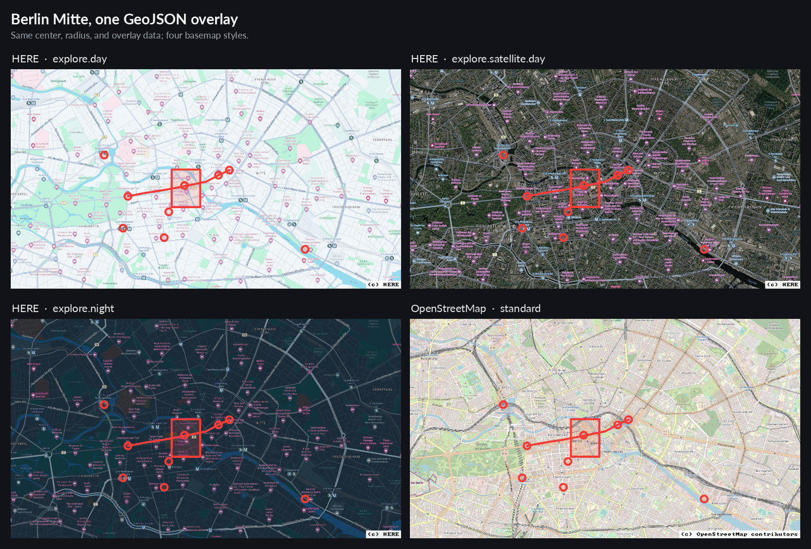

# mapshoot

Native Web Mercator map images from HERE, OpenStreetMap, CARTO, or XYZ PNG
tiles, with GeoJSON overlays. Rust CLI and library, rendered on the CPU with
tiny-skia.



```sh
mapshoot --center 13.405,52.52 --radius 2600 --width 800 --height 450 \
  --geojson examples/berlin.geojson --style examples/berlin-style.json \
  --output berlin-osm.png

export MAPSHOOT_HERE_API_KEY='your-key'   # HERE_API_KEY also works
mapshoot --center 13.405,52.52 --radius 2600 --width 800 --height 450 \
  --basemap here --here-style explore.day \
  --geojson examples/berlin.geojson --style examples/berlin-style.json \
  --output berlin-here.png
```

## Build

```sh
cargo build --release --locked
./target/release/mapshoot --help
cargo install --path . --locked   # installs into ~/.cargo/bin
```

Rust 1.85+ (2024 edition) and a C toolchain are needed to build. Dependencies:
tiny-skia, ureq (rustls), serde, serde_json, sha2, ab_glyph, font8x8.

## CLI

```sh
# Center and radius, with a styled overlay (OpenStreetMap default, no key):
mapshoot --center 13.405,52.52 --radius 1500 \
  --geojson examples/berlin.geojson --style examples/berlin-style.json \
  --output berlin.png

# Colorful per-feature simplestyle, bounds from GeoJSON, no --style file:
mapshoot --geojson examples/simplestyle.geojson \
  --width 800 --basemap none -o simplestyle.png

# Bbox, OpenStreetMap default:
mapshoot --bbox 13.37,52.50,13.44,52.54 --output berlin-osm.png

# CARTO (free key: https://carto.com/basemaps/apikey):
export MAPSHOOT_CARTO_API_KEY='your-key'  # CARTO_API_KEY also works
mapshoot --bbox 13.37,52.50,13.44,52.54 --basemap carto --output carto.png

# XYZ:
mapshoot --bbox 13.37,52.50,13.44,52.54 --basemap xyz \
  --tile-url 'https://tiles.example.com/{z}/{x}/{y}.png' \
  --attribution '(c) Example Maps' --output tiles.png
```

`examples/berlin.geojson` pairs with `berlin-style.json` for one global style.
`examples/simplestyle.geojson` uses only per-feature simplestyle properties.

### Basemaps

| `--basemap` | Provider | Keys (first non-empty) | Style flag |
|---|---|---|---|
| `osm` (default) | OpenStreetMap | none | none |
| `here` | HERE | `MAPSHOOT_HERE_API_KEY`, `HERE_API_KEY` | `--here-style`, default `explore.day` |
| `carto` | CARTO | `MAPSHOOT_CARTO_API_KEY`, `CARTO_API_KEY` | `--carto-style`, default `voyager` |
| `xyz` | any HTTP(S) XYZ provider | in `--tile-url` | none |
| `none` | no tiles | none | none |

HERE styles: `explore.day`, `explore.night`, `explore.satellite.day`, `lite.day`,
`lite.night`, `lite.satellite.day`, `logistics.day`, `logistics.night`,
`logistics.satellite.day`, `satellite.day`, `topo.day`, `topo.night`, `dem`.

CARTO styles: `voyager`, `voyager_nolabels`, `voyager_labels_under`, `light_all`,
`light_nolabels`, `dark_all`, `dark_nolabels`.

OSM is the default and needs no key. It uses `tile.openstreetmap.org`, 256 px
tiles, and defaults to `--max-zoom 19` and `--concurrency 2`; it fetches only the
tiles used by the render. For HERE and CARTO, the `MAPSHOOT_*` key takes
precedence over the unprefixed name; a missing or empty key is an error. CARTO
uses 256 px tiles and permits `--max-zoom` up to 20. OSM and CARTO reject
`--tile-size 512`; `here`, `xyz`, and `none` accept it. `--basemap none` renders
overlays on a `#dddddd` background and warns on stderr.

HERE, OSM, and CARTO draw an attribution footer. XYZ requires `--attribution`:
printable ASCII, validated to fit the image. Requests use
`mapshoot/<version>` as `User-Agent`; `Renderer::with_agent` accepts a custom
`ureq::Agent`.

### Coordinates and framing

Coordinates are longitude, latitude; a bbox is west, south, east, north. Bbox
longitudes span -180..180 and latitudes -85.05112878..85.05112878; the whole
world is `-180,-85.05112878,180,85.05112878`. `west > east` crosses the
antimeridian. `--center`/`--radius` builds a spherical box that wraps in longitude
and clamps at the Mercator limit; radius is 0 < r <= 1,000,000 meters.

`--bbox` or `--center`/`--radius` may be omitted when `--geojson` is given: the
box then covers the GeoJSON positions over the shortest longitude arc and is
clamped to the Mercator latitude limit. It also expands to include the rendered
markers and stroke widths, so graphics are not clipped at the image edge. Empty
documents and zero-extent data such as a single point need `--padding` or
`--buffer`.

The bbox fills the image. Height follows the box aspect ratio in Web Mercator
unless `--height` or `--aspect-ratio` fixes the frame, in which case the box is
fitted inside, centered. `--buffer` grows the box on every side before framing;
`--padding` is a synonym.

Tiles render at zoom `ceil(log2(scale / tile_size))`, capped at `--max-zoom`;
device scale 1 uses nearest filtering, every other scale uses bicubic. Tile
columns wrap at the world edge, and overlays project into the same space.

| Option | Default / meaning |
|---|---|
| `--output`, `-o` | Required `.png` path or `-` for stdout |
| `--bbox`, `--center`, `--radius` | Area selection; optional when `--geojson` supplies it |
| `--width` | 1024 pixels; 1..8192 |
| `--height` | follows the box aspect; explicit height fits the box inside |
| `--aspect-ratio` | `W:H` or a number; fixes the frame |
| `--pixel-ratio` | 1; allowed 1..4; multiplies output dimensions |
| `--buffer` | 0 meters; expands the box; 0..1,000,000 |
| `--padding` | 0 meters; synonym for `--buffer` |
| `--max-zoom` | 19 (OSM default); 0..22 (here/carto 20) |
| `--tile-size` | 256; 256 or 512 |
| `--concurrency` | 2 (OSM default); 1..32 (here/carto 8) |
| `--timeout` | 15000 ms; 1..300000, covers the tile download phase |
| `--no-cache` | Disable the tile cache |
| `--cache-dir` | Cache base directory; default is the system cache directory |
| `--cache-ttl` | 7 days; 1..3650 |
| `--cache-max-mb` | 512; 1..102400 |
| `--tile-url` | XYZ only; HTTP(S) URL with `{z}`, `{x}`, `{y}` |
| `--attribution` | XYZ only; required plain printable ASCII |
| `--geojson`, `--style` | Overlay data and style file |

Logical width and height are 1..8192, and width × height × `--pixel-ratio`² must
not exceed 64 megapixels. A render uses at most 2048 tile placements and 8 MiB
per tile; tiles must be valid PNGs matching `--tile-size`. Rendering and PNG
encoding finish before a temporary file is written and renamed over `--output`,
so failures leave an existing file intact; the output directory must exist. Tile
errors report coordinates, not URLs. Exit status is 1 on error, and `-o -` treats
a broken pipe as success.

### Tile cache

The CLI caches validated tiles in the per-user system cache:
`$XDG_CACHE_HOME/mapshoot/v1` or `~/.cache/mapshoot/v1` on Linux,
`~/Library/Caches/mapshoot/v1` on macOS, and `%LOCALAPPDATA%\mapshoot\v1` on
Windows. `--cache-dir` or `MAPSHOOT_CACHE_DIR` replaces the base directory (the
`mapshoot` part; `v1` is always appended); an empty `MAPSHOOT_CACHE_DIR`
disables caching. `--no-cache` disables it per run.

Entries expire after 7 days and expired entries are fetched again. The cache is
capped at 512 MiB and trimmed oldest-first to 90% of the cap. URLs are SHA-256
hashed, so credentials and query strings never appear in cache paths; cache
directories and files are created private to the user (0700/0600 on Unix).
Missing or corrupt entries are refetched, and runtime cache I/O failures are
ignored. An unusable `--cache-dir` is an error. Expired tiles are not served
when the network fails.

### GeoJSON and styling

Accepts Feature, FeatureCollection, GeometryCollection, Point, LineString,
Polygon, and their Multi variants; null geometries and empty collections are
allowed. Polygon rings must be closed; holes fill with even-odd. Points draw as
circles, lines with round caps and joins, all antialiased and clipped to the
image.

`--style` is a JSON object:

```json
{
  "color": "#e63946",
  "fillColor": "#e63946",
  "weight": 3,
  "opacity": 1,
  "fillOpacity": 0.25,
  "radius": 6
}
```

Global style colors are `#RRGGBB`, opacities 0..1, widths 0..1024 and radii in
logical pixels. Defaults: `#3388ff`, weight 3, opacity 1, fillOpacity 0.2,
radius 6; `fillColor` falls back to `color`. Unknown fields are errors.

Features can override the global style with
[simplestyle](https://github.com/mapbox/simplestyle-spec) properties:

- `marker-color` (solid marker fill and outline), `marker-size` (`small`,
  `medium`, `large` = 5, 7, 9 px radius), `marker-symbol` (one ASCII letter or
  digit, drawn at a fixed 13 px size and centered; other icon IDs are ignored).
  These apply only to points.
- `stroke`, `stroke-opacity`, `stroke-width` apply to lines and polygon outlines.
- `fill`, `fill-opacity` apply to polygon interiors.

Simplestyle colors accept `#RGB`, `#RRGGBB`, and both forms without `#`. Values
that are not specified keep the global style. `title`, `description`, and
unknown properties are ignored; invalid values for recognized properties are
errors. Multi geometries inherit the style of their feature.

## Library

```rust
use mapshoot::{Basemap, Bounds, Options, Renderer};

let mut options = Options::new(
    Bounds::from_center(13.405, 52.52, 1500.0)?,
    Basemap::Here { api_key: "your-key".into(), style: "explore.day".into() },
);
options.geojson = Some(serde_json::from_str(
    r#"{"type":"Point","coordinates":[13.405,52.52]}"#,
)?);
let image = Renderer::default().render(&options)?;
image.save_png("berlin.png")?;
```

`mapshoot::render(&options)` is the one-shot form; `Renderer` reuses HTTP
connections. `Renderer::with_cache(cache)` enables persistent tile caching;
`Cache::system()` uses the defaults above and `Cache::at(path, ttl, max_bytes)`
accepts custom limits. The one-shot form and `Renderer::default()` do not cache.
`Basemap` also has `None`, `Osm`, `Carto { api_key, style }`, and
`Xyz { url, attribution }`; styles are listed in `HERE_STYLES` and
`CARTO_STYLES`. `height` is `Option<u32>`: `None` follows the bbox aspect,
`Some(h)` fits the box inside.
`Bounds` provides `new`, `from_center`, `buffered`, and `aspect`;
`from_geojson(value, margin)` derives bounds from a GeoJSON document over the
shortest longitude arc. `Options::include_geojson_graphics` expands such bounds
by the marker and stroke extents (the CLI does this automatically). Errors carry
`kind()` — `InvalidInput`, `Http(u16)`,
`Network`, `Timeout`, `Other` — and `Debug` output redacts keys and tile URLs.

## Development

```sh
cargo fmt --check
cargo clippy --all-targets --locked -- -D warnings
cargo test --locked
```

CI runs these on stable Rust (`.github/workflows/ci.yml`). Tests use local HTTP
fixtures.

## Releases and packaging

Pushing a `v*` tag builds and publishes a GitHub Release via cargo-dist
(`.github/workflows/release.yml`, configured in `dist-workspace.toml`). Each
release carries:

- fully static musl tarballs for `x86_64` and `aarch64`, each holding the
  binary, the README, both license files, and the embedded font's license;
- macOS tarballs for Intel and Apple Silicon;
- a `curl | sh` installer;
- native `.deb`, `.rpm`, and `.apk` packages built from the static binaries;
- `sha256.sum` and `mapshoot-packages.sha256` checksums, a CycloneDX SBOM, and
  SLSA build provenance attestations.

The Linux binaries are statically linked against musl and have no runtime
dependencies, so one tarball runs on glibc distributions and Alpine alike. That
is why the packages declare no dependencies and there are no separate `-gnu`
builds.

Packaging lives in `packaging/`:

| Path | Purpose |
|---|---|
| `nfpm.yaml` | shared deb/rpm/apk package definition |
| `build-packages.sh` | builds the packages from the staged musl binaries |
| `copyright` | Debian machine-readable copyright |

Packages can be built locally too:

```sh
dist build --target x86_64-unknown-linux-musl
MAPSHOOT_PACKAGE_TARGETS=x86_64-unknown-linux-musl packaging/build-packages.sh
```

The `.deb` and `.rpm` install the binary to `/usr/bin/mapshoot`, a man page to
`/usr/share/man/man1`, and the license files. The `.apk` is unsigned, so
installing it directly needs `apk add --allow-untrusted ./mapshoot-amd64.apk`.
Verify a release artifact with `gh attestation verify <file> --repo
baol/mapshoot`.

## License

Dual licensed under Apache-2.0 ([LICENSE-APACHE](LICENSE-APACHE)) or MIT
([LICENSE-MIT](LICENSE-MIT)), at your option. Marker symbols use the embedded
Space Grotesk font (SIL OFL 1.1); see [assets/OFL.txt](assets/OFL.txt). The
attribution footer uses the 8x8 bitmap font from the `font8x8` crate (MIT).
